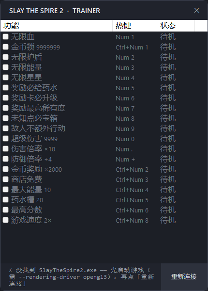

# STS2 Trainer

《Slay the Spire 2》单机修改器 —— **C# + ClrMD 按「类型::方法名」实时定位并 inline hook**，不写死偏移，不改游戏文件，不动存档。

> 仅用于**单人/离线**游戏与**逆向工程学习**。请勿用于联机或任何影响他人的场景。



## 下载

成品在 [Releases](https://github.com/Rookie-chick/STS2Trainer/releases) 里，`STS2Trainer.exe` 是 self-contained 单文件，**目标机器不需要装 .NET**。

仓库里不放 exe（单个约 70MB，进 git 历史会让 clone 变得很重），需要自己编译就看下面的「自行构建」。

---

## 特性

- **19 项功能**，热键开关（对齐原版 Plus20 的编号习惯），勾选框与热键双向同步
- **不写死偏移**：靠 .NET 元数据（ClrMD）按方法名取址，游戏小版本更新通常不用改代码
- **只改内存**：代码洞 + `jmp` 补丁，关窗口自动还原，不动游戏文件/存档
- **无边框小窗**：自绘标题栏、功能列表、状态列（`✓ / 未JIT / 缺地址 / 挂点被占用 / 安装失败`）
- **延迟安装**：.NET 是"用到才编译"，未 JIT 的方法会在游戏执行到它时自动补装（每 3 秒重试）

## 功能与热键

| 热键 | 功能 | 挂钩的游戏方法 |
|---|---|---|
| `Num 1` | 无限血 | `Creature::set_CurrentHp` |
| `Num 2` | 无限护盾 | `Creature::set_Block` |
| `Num 3` | 无限能量 | 帧钩子写 `PlayerCombatState._energy` |
| `Num 4` | 无限星星 | 帧钩子写 `PlayerCombatState._stars` |
| `Num 5` | 奖励必给药水 | `PotionRewardOdds::Roll` → true |
| `Num 6` | 奖励卡必升级 | `Hook::ModifyCardRewardUpgradeOdds` → 1 |
| `Num 7` | 奖励最高稀有度 | `CardRarityOdds::GetBaseOdds` → 999f |
| `Num 8` | 未知点必宝箱 | `UnknownMapPointOdds::Roll` → Treasure |
| `Num 9` | 敌人不额外行动 | `Hook::ShouldTakeExtraTurn` → false |
| `Num 0` | 超级伤害 9999 | `Hook::ModifyDamage`（2 个重载） |
| `Num .` | 伤害倍率 ×10 | 同上 |
| `Num +` | 防御倍率 ÷4 | 同上（`target == 玩家` 分支） |
| `Ctrl+Num 1` | 金币锁 9999999 | 帧钩子写 `Player._gold` + 刷 `NTopBarGold` |
| `Ctrl+Num 2` | 金币奖励 ×2000 | `EncounterModel::get_Min/MaxGoldReward` |
| `Ctrl+Num 3` | 商店免费 | `Hook::ModifyMerchantPrice` → 0 |
| `Ctrl+Num 4` | 最大能量 10 | `Hook::ModifyMaxEnergy` → 10 |
| `Ctrl+Num 5` | 药水槽 20 | `Player::SetMaxPotionCountInternal` → 20 |
| `Ctrl+Num 6` | 最高分数 999999 | `ScoreUtility::CalculateScore`（2 个重载） |
| `Ctrl+Num 8` | 游戏速度 2× | `Godot.Engine::set_TimeScale` |

## 快速开始

1. 启动游戏（虚拟机/无独显需带参数，否则 .NET 运行时不会加载）：
   ```powershell
   SlayTheSpire2.exe --rendering-driver opengl3 --rendering-method gl_compatibility
   ```
2. 进入有角色的画面（战斗里最好，血量有数字）
3. 从 [Releases](https://github.com/Rookie-chick/STS2Trainer/releases) 下载 `STS2Trainer.exe`，双击运行（会请求管理员权限——读写别的进程内存必须）
4. 底栏出现 `✓ 已连接 pid=xxxx  已就绪 N/19 个功能` 即可勾选或按热键

> exe 为 **self-contained 单文件**发布：目标机器**不需要安装 .NET**。

## 目录结构

```
.
├─ src/
│  ├─ sts2trainer/          控制台版（侦查 + 注入的核心库，也是调试入口）
│  │   Game.cs              ClrMD 只读层：找对象/字段/方法
│  │   Hook.cs              注入层：帧钩子 / setter / 强制返回 / decimal 参数 / ModifyDamage
│  │   Program.cs           控制台前端：功能表 + 全局热键
│  └─ sts2trainer-ui/       WinForms 界面版（成品），复用上面两个文件
├─ docs/
│  ├─ tutorial.html         单文件图文教程（0~32 节，20 个功能逐篇）
│  ├─ notes/                同上，Markdown 版
│  └─ images/ui.png
├─ dist/                    本地构建输出（exe 不进仓库，见 Releases）
├─ build.ps1                一键构建 + 打包
└─ LICENSE                  MIT
```

## 自行构建

需要 **.NET 8 SDK**（Windows x64）。

```powershell
# 控制台版
dotnet build src/sts2trainer -c Release

# 界面版 + self-contained 单文件发布（产出 dist/STS2Trainer.exe）
dotnet publish src/sts2trainer-ui -c Release -r win-x64 --self-contained true `
  -p:PublishSingleFile=true -p:IncludeNativeLibrariesForSelfExtract=true `
  -p:EnableCompressionInSingleFile=true -o dist
```

或直接：`powershell -ExecutionPolicy Bypass -File build.ps1`

## 工作原理（三句话）

1. **定位**：ClrMD 附加到游戏进程，遍历托管堆拿到 `ClrType`；**静态类**（如 `Hook`）没有实例，改用 `EnumerateModules().GetTypeByName()`。
2. **改址**：在目标方法附近分配代码洞（`VirtualAllocEx`，±2GB 内保证 `E9 rel32` 够得着），写入自己的机器码，把方法入口改成 `jmp 代码洞`。
3. **开关**：代码洞里先 `cmp dword [开关],0 / je 跳过`，所以"开/关功能"只是往 4 个字节写 1/0，不用重新打补丁。

四种钩子形态：**帧钩子**（每帧写字段 + 调 UI 刷新）、**setter 钩子**（改 `edx` 参数）、**强制返回**（`mov eax,值; ret`）、**decimal 参数/返回**（16 字节结构体，返回值走 `rcx` 隐藏指针，参数因此整体右移一格）。

## 已知问题

| 现象 | 原因 | 处理 |
|---|---|---|
| 某功能显示 `未JIT` | 该方法游戏还没执行过（.NET 用到才编译） | 打完一场 / 进奖励面板 / 进商店后自动变 `✓` |
| 显示 `挂点被占用` | 上次工具被强杀，内存补丁仍在（`E9`） | **重启游戏**（唯一解法） |
| 某功能显示 `缺地址` | ClrMD 枚举不到该方法（如 `Player::set_Gold`） | 已改用等价手段（帧钩子写字段） |
| 游戏闪退 | 代码洞里调用的 UI 方法内部抛异常（裸机器码没有 unwind 信息） | 记录当时按了哪个热键；重启游戏即可，不影响存档 |

## 与原版 Plus20 Trainer 的差异

- 功能 19 项；原版第 20 项「分数倍率」需要尾部 hook（改写每个 `ret` 前的 `eax`），本版用「最高分数 = 999999」等价覆盖
- 13 项挂法与样本完全一致；伤害三项按样本改为 `Hook::ModifyDamage` 的两个重载；
  金币/能量/星星因 ClrMD 枚举不到样本用的 `set_Gold` / `LoseEnergy` / `LoseStars`，改用帧钩子写字段
- 界面为仿制（无边框圆角 + 勾选列表），非逐像素复刻

## 免责声明

本项目仅供**个人学习与逆向工程研究**，针对**单人离线**游戏。作者不对使用后果负责，
不提供任何游戏本体或反编译产物。请在下载后 24 小时内删除，或用于支持正版。

## 许可

[MIT](LICENSE)
